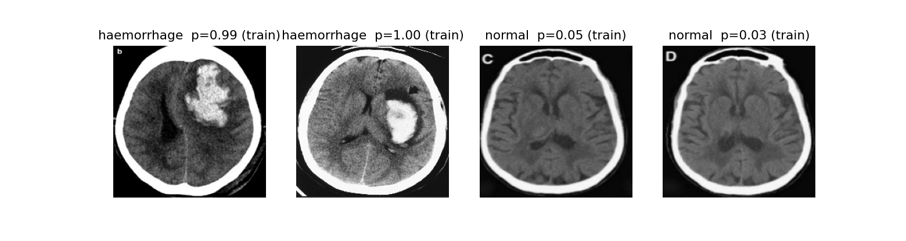
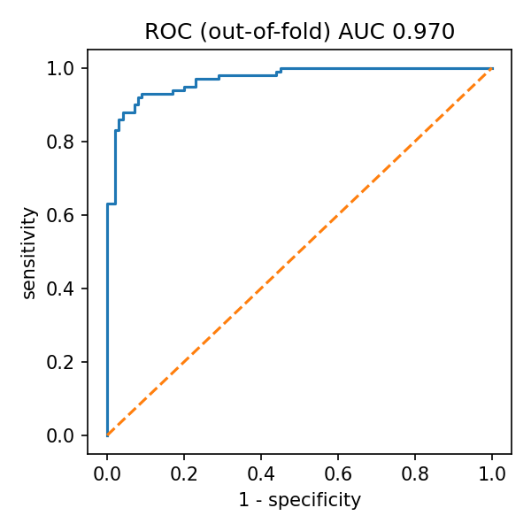

# Intracranial haemorrhage detection on head CT (EfficientNetB0)

Binary classifier (haemorrhage vs normal) for 2D head CT slices, fine-tuned from ImageNet EfficientNetB0, with a Grad-CAM heatmap and a web demo.

> **Research prototype. Not a medical device. Not for clinical use.** Trained on a small public dataset only; no patient data is included in this repository.

**Demo:** a Gradio app is in `demo/` (see Run it below). There is no hosted version yet.




## Results (5-fold stratified cross-validation, 200 slices)

Out-of-fold predictions at threshold 0.5, 95% confidence intervals from 1,000 bootstrap resamples.

| Metric | Value | 95% CI |
|---|---|---|
| Accuracy | 91.0% | 87.0 to 94.5% |
| Sensitivity | 90.0% | 83.7 to 95.3% |
| Specificity | 92.0% | 86.1 to 96.7% |
| AUC-ROC | 0.970 | 0.951 to 0.988 |

Confusion matrix: TN 92, FP 8, FN 10, TP 90 (`results/metrics.json`, figures in `results/`).

## Method

- Data: Kaggle `felipekitamura/head-ct-hemorrhage`, 200 head CT slices (100 haemorrhage, 100 normal).
- Model: EfficientNetB0 (ImageNet), frozen base + global average pooling + dropout 0.4 + sigmoid head (Adam 1e-3, 15 epochs), then fine-tuning of the full backbone with BatchNorm frozen (Adam 1e-5, 15 epochs). Light augmentation (flip, rotation, zoom, contrast).
- Evaluation: 5-fold stratified cross-validation, because 200 images is too few for a meaningful single test split. The demo model is retrained on all 200 slices with the same recipe.
- Explainability: Grad-CAM on the last convolutional block.

## Limitations (read before quoting the numbers)

- Only 200 slices. The confidence intervals are wide and the results are not evidence of clinical performance.
- The dataset has no patient identifiers, so slices from the same patient may be in different folds. This can inflate cross-validation scores.
- Single source, no external validation, no haemorrhage subtype and no localisation.
- A per-slice classifier is not a study-level triage tool. Real triage works on whole volumes.
- Grad-CAM shows where the network looked, not that it found a lesion.

## Run it

Train (Google Colab, free T4 GPU): open `ich_head_ct_training.ipynb` and run all cells. It saves `ich_effnetb0.keras` and `metrics.json`.

Demo locally:

```bash
cd demo
pip install -r requirements.txt
# put ich_effnetb0.keras in this folder
python app.py
```

## Author

Abdullah Ghani, data and AI engineering student at ECE Paris.
